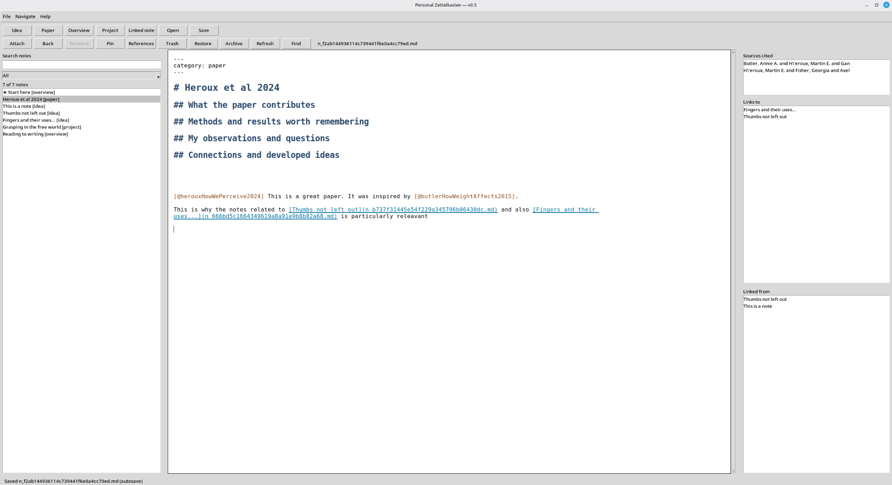
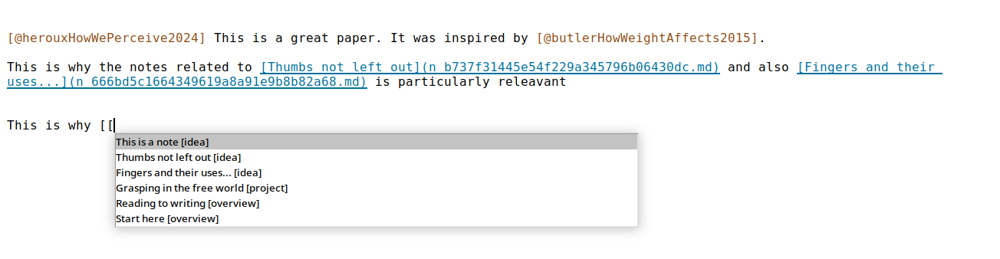
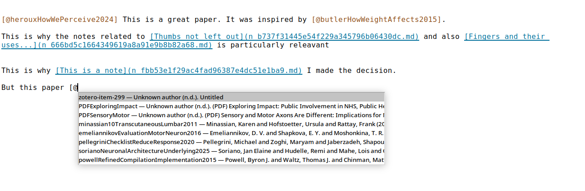
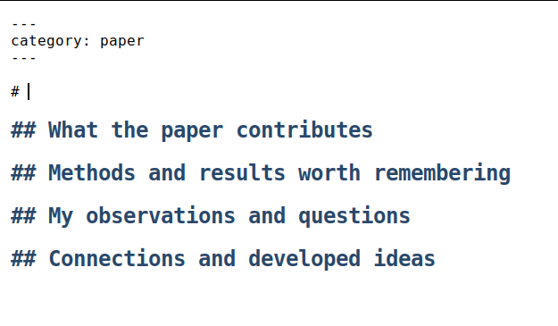

 <p align="center">
  
</p>

A lightweight, local-first Markdown note editor for **connecting ideas, papers, and projects**. Built with Python and Tkinter, inspired by the Zettelkasten workflow discussed in Sönke Ahrens’s *How to Take Smart Notes*.

**Current version: 0.5.4 — experimental Linux pilot.**

Tested by the project author on Linux Mint; other platforms are not yet verified. Back up your notes independently before relying on the application for important work.



## Why this application?

My Zettelkasten helps you write, connect, and retrieve ideas using ordinary Markdown files.

It is designed to support the development of ideas from reading and research through to writing, without locking your notes into a proprietary format. Your collection remains readable even without the application.

The application is deliberately modest: it does not aim to replace Zotero, a PDF reader, or a manuscript editor.

### Features

**Writing and connecting notes**
- Markdown editor with **visible syntax** and live styling for headings, emphasis, links, code, and citations.
- Idea, Paper, Overview, and Project notes with simple templates and stable note filenames.
- Fast `[[` note linking, backlinks, searchable inventory, pinned notes, and browser-style Back/Forward history.
- An editable, pinned **Start here** tutorial for newly created collections.

**Managing collections**
- Create, open, and close collections directly from the application.
- Store collections anywhere, including Dropbox or other synchronised folders.
- Automatically reopen the last-used collection when starting the application.
- Access up to 10 previously opened collections through **File → Recent Collections** or the welcome screen.
- Identify the active collection by its name in the window title and its location in the status bar.
- Manage collections without remembering command-line arguments.

**References and attachments**
- `[@` citation autocomplete using a **read-only** Better BibTeX export from Zotero.
- Create or reopen Paper notes from bibliography entries.
- Attach figures and PDFs as copied local files.

**Safety and usability**
- Autosave, recovery copies, recoverable deletion, project archiving, and external-edit conflict warnings.
- Helpful warnings when a collection is unavailable, without automatically recreating missing folders.
- **Help → About My Zettelkasten** displays the installed application version.
- `--version` command-line option for checking the installed version.

## Latest release

**v0.5.4 — Version Information**

This release adds an About dialog and a command-line version option, making it easier to identify which version of My Zettelkasten is installed.

For previous improvements, including collection management and Recent Collections, see the [Changelog](CHANGELOG.md) or [GitHub Releases](https://github.com/MartinHeroux/my-zettelkasten/releases).

## Installation (Linux Mint / Ubuntu)

My Zettelkasten requires Python 3.10+ and Tkinter. It has been tested on Linux Mint 22.3.

### Recommended: Automatic installation

The included installation script sets up My Zettelkasten as a desktop application, including its Python environment and Linux Mint application-menu launcher.

Clone the repository:

```bash
git clone https://github.com/MartinHeroux/my-zettelkasten.git
cd my-zettelkasten
```

Run the installer:

```bash
bash scripts/install-linux.sh
```

The script automatically:

- Installs the required system dependencies.
- Creates a dedicated Python virtual environment.
- Installs My Zettelkasten from GitHub.
- Creates a `my-zettelkasten` terminal command.
- Adds My Zettelkasten to the Linux Mint application menu with its branded icon.

Once installation finishes, search for **My Zettelkasten** in the Linux Mint application menu.

Alternatively, launch it from a terminal:

```bash
~/.local/bin/my-zettelkasten
```

On first launch, create a new collection or open an existing one. My Zettelkasten remembers the last-used collection for subsequent launches.

### Checking the installed version

```bash
~/.local/bin/my-zettelkasten --version
```

### Updating

Run the installation script again to download and install the latest version from GitHub:

```bash
bash scripts/install-linux.sh
```

Your note collections are stored separately from the application and are not modified by the installation script.

For manual installation, development setup, troubleshooting, and additional information, see the [full installation guide](docs/INSTALLATION.md).
## First five minutes

1. **Create or open a collection** using the welcome screen.
2. Open the pinned **Start here** note and follow its links.
3. Click **Idea** or press `Ctrl+Shift+I`; type your title after `# `.
4. Type `[[` to search for and insert a link to another note. Use `Ctrl+Shift+L` to create a new linked Idea note.
5. Use the sidebar search, Pinned and Recent notes, and **Links to / Linked from** to explore relationships between ideas.

You can switch collections at any time using the File menu. Previously opened collections are available under **File → Recent Collections**.

Optionally, connect Zotero using **File → Choose bibliography**, then type `[@` to insert citations.

Read the [Quick start](docs/QUICK_START.md) and [Keyboard shortcuts](docs/KEYBOARD_SHORTCUTS.md) for more information.

## Zotero + Better BibTeX

Zotero manages references, PDFs, and PDF annotations. My Zettelkasten manages your Markdown Paper and Idea notes.

The connection is a `.bib` file that Better BibTeX can **automatically re-export** whenever your Zotero library changes. My Zettelkasten reads that file and remembers its location for the collection.

**The application does not modify Zotero or synchronise Zotero notes.**

To configure the integration:

1. Install [Zotero](https://www.zotero.org/) and [Better BibTeX](https://retorque.re/zotero-better-bibtex/).
2. In Zotero, right-click **My Library → Export Library**.
3. Choose **Better BibTeX**, enable **Keep updated**, and save the export to a stable location.
4. In My Zettelkasten, select **File → Choose bibliography**.
5. Verify the connection using `[@` citation completion and the References window.

For detailed instructions and troubleshooting, see [Zotero and Better BibTeX setup](docs/ZOTERO_SETUP.md).

| Note linking (`[[`) | Zotero citation completion (`[@`) |
|:--:|:--:|
|  |  |

**Paper-note template** — headings are prefilled so you can start with the title:



## Where are my notes?

A **collection** is an ordinary directory containing your notes and associated files.

Its structure includes:

- `notes/` — Markdown note files.
- `attachments/` — copied figures and documents.
- `settings.json` — collection-specific settings.
- Recovery and trash folders — support recovery and deletion workflows.

The bibliography file may be stored inside or outside the collection.

**Your notes are separate from the application code and Python environment.** Updating or reinstalling My Zettelkasten does not require moving your collections.

Keep independent backups of the entire collection, and back up Zotero separately. See [Backup and recovery](docs/BACKUP_AND_RECOVERY.md).

## Status and limitations

My Zettelkasten is an **experimental pilot**, not a data-loss guarantee.

It has been tested on Linux Mint, but broad multi-user, cross-platform, and large-library testing is incomplete.

Current limitations include:

- No automatic Zotero-note synchronisation.
- No rendered WYSIWYG Markdown editor.
- No mobile application.
- Attached files are copied into collections rather than linked to their original locations.
- Bibliography integration is read-only.

Please test with disposable notes before using the application for important work. Report reproducible problems through GitHub Issues.

## Future improvements

We maintain a curated [ROADMAP.md](ROADMAP.md) of possible improvements. These are ideas, not commitments.

Potential improvements include clipboard image pasting, linking existing files without copying them, improved Zotero item links, optional Markdown preview, and further refinements to collection switching.

Suggestions and bug reports are welcome through [GitHub Issues](https://github.com/MartinHeroux/my-zettelkasten/issues).

## Documentation and development

**User documentation**

- [Installation](docs/INSTALLATION.md) · [Quick start](docs/QUICK_START.md) · [Zotero setup](docs/ZOTERO_SETUP.md)
- [Keyboard shortcuts](docs/KEYBOARD_SHORTCUTS.md) · [Backups](docs/BACKUP_AND_RECOVERY.md)

**Project documentation**

- [Pilot checklist](docs/PILOT_CHECKLIST.md) · [Changelog](CHANGELOG.md) · [Roadmap](ROADMAP.md)

Run the unit tests from the project root:

```bash
python -m unittest discover -s tests -v
```

Tkinter GUI smoke tests can run on a Linux desktop or with:

```bash
xvfb-run -a python tests/gui_smoke.py
```

Install `xvfb` if necessary. Automated tests are useful but do not replace manual testing on a desktop.

## License

[MIT](LICENSE).

This project is independent of Zotero, Better BibTeX, and the author and publisher of *How to Take Smart Notes*.