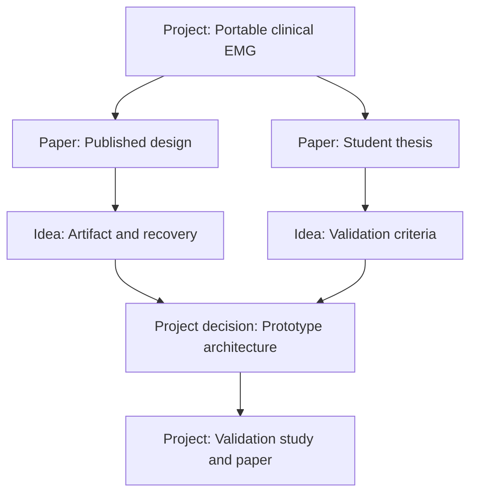

> Workflow update (v0.5.6): All source-specific literature notes in this example belong in Zotero. In the app, keep Permanent, Project and Entry-Point notes; cite sources with `[@key]`. Literature notes in Zotero are not local `[[` link targets. Older diagrams below illustrate conceptual relationships.

# Portable EMG Project in the Zettelkasten

*A practical worked example of using Literature, Permanent and Project notes together*

I think this is an excellent example of why a Zettelkasten can be useful beyond conventional academic writing. In fact, **I would keep this entire EMG development effort within your Z, but distinguish carefully between the knowledge you're developing and the practical work of building the device.**

There is an important distinction here: **a Zettelkasten is not exclusively a collection of scientific theories, arguments or debatable claims. It is a system for developing reusable understanding.**

Understanding why an EMG amplifier needs particular characteristics, how stimulation artifacts affect measurements, or what makes a device suitable for clinical use is just as legitimate a subject for a Z as understanding the physiological mechanisms underlying spinal stimulation.

But I would not try to turn every component choice, supplier email or PCB revision into a permanent Permanent note.

## 1. The key distinction: Knowledge versus project execution

Your portable EMG project contains at least three kinds of intellectual work.

| Kind of work | Example | Where it belongs |
|---|---|---|
| Reusable knowledge | Why stimulation artifacts can saturate EMG amplifiers | Permanent note |
| Source-specific information | How a published portable EMG system handles amplifier recovery | Literature note |
| Project-specific decisions | Which amplifier architecture you decide to prototype | Project note |

There is also a fourth category: practical records such as PCB designs, component lists, firmware, test datasets and supplier documentation.

Those belong in the project's technical files, not necessarily in your Z. The Z can link to them.

**The distinction isn't scientific versus engineering. It's reusable understanding versus project-specific execution.**

A technical decision can also be an intellectual contribution. The key is recording its reasoning, not just the final choice.

## 2. I would begin with one Project note

In our application, press `Ctrl+Shift+J` and create:

**Portable EMG system for clinical reflex assessment**

This would be your central project overview.

For example:

> **PROJECT NOTE — Portable EMG system for clinical reflex assessment**
>
> **Purpose**
>
> Develop a portable EMG system that can record stimulation-evoked responses reliably in a clinical environment and support more consistent selection of stimulation intensity during therapy.
>
> **Current challenges**
>
> - Understand the existing portable EMG designs.
> - Determine how to manage large stimulation artifacts.
> - Identify the hardware and software requirements.
> - Establish what can realistically be built and validated.
> - Compare performance with a conventional laboratory system.
>
> **Related knowledge**
>
> - [[Stimulation artifacts can obscure early evoked responses]]
> - [[Amplifier saturation and recovery affect measurable responses]]
> - [[Clinical reflex assessment requires reproducible measurement conditions]]
>
> **Decisions and open questions**
>
> - Which published architecture should be used as a starting point?
> - What technical assistance is required?
> - Which performance criteria must be demonstrated before clinical testing?

Notice that this is not a conventional permanent Permanent note. It's a working document that will change as the project evolves.

You can pin it, return to it regularly and use it as the central entry point for everything related to the project.

But the knowledge notes linked from it remain independent.

## 3. How the different notes might develop

Let's imagine that you begin by reading a recent paper describing a portable EMG system.

The paper discusses how its hardware handles the large electrical artifacts associated with stimulation.

You would create a Literature note associated with its Zotero reference.

> **LITERATURE NOTE — Portable EMG acquisition system — Author et al.**
>
> *Illustrative source, not an actual bibliographic reference.*
>
> **What the paper contributes**
>
> Describes a portable acquisition architecture intended to record evoked responses under conditions where stimulation artifacts can be substantial.
>
> **Methods and results worth remembering**
>
> - Amplifier configuration and input range.
> - Sampling and resolution.
> - Artifact-management strategy.
> - Recovery time after stimulation.
> - Validation against a reference recording system.
>
> **My observations and questions**
>
> The reported results appear promising, but do they establish that the system can resolve the responses and latencies needed for our clinical application?
>
> **Connections**
>
> - [[Amplifier recovery can limit the earliest measurable response]]
> - [[Validation of portable EMG requires more than waveform similarity]]

You might read the associated student thesis next.

The thesis could provide far more practical detail than the paper: component selection, circuit diagrams, firmware architecture, problems encountered during prototyping and tests that didn't appear in the publication.

I would create **a separate Literature note for the thesis**, even though it relates to the same system.

Why? Because the thesis is a distinct source with potentially different levels of detail and evidence.

The two Literature notes should link to each other, explaining their relationship.

Manufacturer datasheets and manuals can also be entered into Zotero and associated with Literature notes. In our application, *Paper* is effectively the category for source-focused notes, not only peer-reviewed journal articles.

## 4. The most valuable Permanent notes may be technical

This is where I think the Z becomes particularly useful for your project.

As you read the paper and thesis, you encounter engineering concepts that you need to understand before making design decisions.

Rather than repeatedly returning to the same source or trying to remember everything, you develop your own explanations.

Here are four examples.

### Permanent note 1 — Measurement

**Amplifier recovery time can determine which evoked responses are measurable**

A large stimulation artifact may drive an acquisition stage outside its linear operating range. The resulting recovery period can obscure physiological signals occurring shortly after stimulation.

The relevant design question is therefore not simply how much artifact is present, but whether the complete recording chain recovers sufficiently before the response of interest.

**Links:** [[Stimulation artifacts]], [[Input range and gain]], [[Clinical response latency]]

### Permanent note 2 — Engineering

**Increasing amplifier gain can create a trade-off between sensitivity and artifact tolerance**

Higher gain may improve the representation of small signals but can reduce the input amplitude that the recording chain can accommodate without saturation.

This trade-off must be considered alongside noise, electrode conditions, amplifier architecture and any protection or blanking strategy.

**Links:** [[Amplifier recovery]], [[EMG noise floor]], [[Dynamic range]]

### Permanent note 3 — Validation

**Agreement between EMG systems depends on the intended measurement**

Two systems might produce visually similar waveforms while differing in latency, amplitude estimation, baseline noise or trial-to-trial variability.

Validation criteria should therefore follow from the clinical decision the instrument is intended to support.

**Links:** [[Measurement agreement]], [[Response amplitude estimation]], [[Clinical intensity selection]]

### Permanent note 4 — Clinical interpretation

**Reliable evoked responses do not automatically establish an optimal therapy intensity**

A technically reliable response measurement is only one part of the problem. The relationship between the measured response, stimulation intensity, physiological recruitment and therapeutic goals must also be established.

**Links:** [[Reflex recruitment curves]], [[Stimulation intensity]], [[Physiological interpretation of evoked responses]]

These are illustrative starting explanations, not established findings from the specific papers you're reading. You would refine and qualify them using the literature, manufacturer's specifications and your own measurements.

Notice something important: **these notes could remain useful even if you abandon the portable EMG project.**

You might use them later when teaching electrophysiology, reviewing a manuscript, evaluating a commercial system or designing a different experiment.

That is precisely why they deserve to exist independently of the project.

## 5. Where do actual design decisions belong?

Suppose you've read several sources and must decide how to approach artifact management.

This is a different kind of writing from an Permanent note.

I would create a linked Project note titled:

**Design decision — Approach to stimulation artifact management**

It might contain:

| Section | Example content |
|---|---|
| Problem | Stimulation artifacts may prevent reliable recording of early evoked responses |
| Requirements | Recover before the response window of interest; preserve waveform fidelity |
| Options | Different amplifier architectures, gain strategies, hardware blanking or other artifact-management approaches |
| Evidence | Links to the relevant Paper and Permanent notes |
| Decision | Chosen approach, initially marked provisional |
| Rationale | Why it appears appropriate for the intended measurement |
| Risks | What remains untested |
| Next step | Questions for an electronics collaborator and bench-validation plan |

This is where you record **why you made a particular engineering choice**.

You might later discover that your initial decision was unsuitable. That's fine. The Project note should preserve the reasoning and the evidence that led you to revise it.

I would date significant decisions rather than silently replacing their history.

The detailed circuit files, PCB revisions and code can live in a separate engineering project directory or Git repository, linked from the Project note.

For an electrically connected clinical device, design and testing also need appropriate engineering expertise, electrical safety assessment and regulatory review. The Z can document that reasoning, but isn't a substitute for those processes.

## 6. What the network might look like

Here's a simplified representation of how these notes could relate.

*Conceptual illustration. The actual application uses ordinary Markdown links and backlinks, not a graph interface.*

The important point is that there isn't a rigid sequence in which notes must be created.

You might start with a Project note, then create Literature notes, then Permanent notes. Or you might begin with a technical question that becomes an Permanent note and later informs the project.

The relationships emerge from the work.

## 7. How I would organize your actual workflow

Imagine a typical week.

**Monday — Read the published paper.** Open the PDF in Zotero and create a literature note in Zotero. Record the architecture, reported performance, relevant figures and uncertainties. Create an Permanent note if you need to develop an explanation of amplifier recovery.

**Tuesday — Work through the thesis.** Create a separate Literature note. Link it to the publication. Extract technical details needed to understand the design, and note which questions remain unanswered. Don't create an Permanent note for every resistor or circuit component.

**Wednesday — Compare approaches.** Search your existing notes about stimulation artifacts, evoked-response measurement and clinical requirements. Develop a Project note comparing design options. Link to the relevant sources and reusable explanations.

**Thursday — Meet an engineer.** Record practical questions and decisions in the Project note. If the discussion teaches you a general principle about measurement systems, develop or revise an Permanent note.

**Friday — Review the project.** Update the project overview: what is understood, what remains uncertain, which decisions are provisional, and what needs to happen next.

You could repeat this cycle for months.

The value is that you won't need to reconstruct your reasoning every time you return to the project after a few weeks away.

## 8. What about your existing notebook?

This is where I think your Z could make a particularly large difference.

Suppose your notebook contains:

> Need to check if amplifier can recover quickly enough after pulse. Maybe the artifact problem is more important than resolution. Ask engineer.

That is a perfectly good fleeting note. Capture it with `Ctrl+Shift+N` and return to it through **Inbox**. Use **Develop** if it needs a new Permanent note, or transfer the useful parts into existing notes. **Develop** saves and opens the Permanent note, then permanently deletes the fleeting original and its recovery copies automatically. If you instead transfer text into existing notes, use **Note → Move to Trash** or **Delete Permanently** when finished.

When you process it, you might separate it into three parts:

| Original thought | Destination |
|---|---|
| Why might recovery time matter more than nominal resolution? | Develop an Permanent note |
| Determine acceptable recovery time for our intended responses | Add an open question to the EMG Project note |
| Ask engineer about input saturation and recovery behaviour | Project action list |

You don't have to copy the entire notebook entry into the Z.

Instead, **you transform the original observation into material that can be found, understood and acted upon later**.

This is a major difference from simply digitizing your notebooks.

For study ideas that aren't yet active projects, I'd generally create an Permanent note explaining the proposed question, its rationale, and what evidence would make it worth investigating. A brief thought can stay in Inbox until you've developed it. Create a Project note when you're actually organizing work around the study.

That prevents the Z from becoming a graveyard of dozens of nominal projects that never started.

## 9. The most important conceptual distinction

I think your hesitation comes from imagining a Zettelkasten as primarily a place for scientific propositions such as:

*Does transcutaneous spinal stimulation facilitate motoneuron excitability through dorsal-root recruitment?*

That certainly belongs in a Z.

But consider this question:

*What technical and physiological requirements must an EMG system satisfy to support reliable clinical decisions about stimulation intensity?*

That also involves developing understanding, weighing evidence, recognizing uncertainty and connecting concepts.

In fact, it spans several domains:

- Electrophysiology and signal acquisition.
- Engineering design and measurement limitations.
- Physiological interpretation.
- Clinical workflow and reliability.
- Experimental validation.

These connections are exactly what a Z can help you develop.

**A Zettelkasten isn't restricted to debatable propositions. It can also contain well-explained technical principles, methodological distinctions, practical insights and questions that lead to further inquiry.**

The critical requirement is that the permanent Permanent notes remain understandable and potentially reusable beyond the immediate project.

## 10. My recommendation for your EMG project

I would start with just five notes, rather than trying to design the entire knowledge structure in advance:

1. A **Project note** for the portable clinical EMG system, pinned in the sidebar.
2. A **Literature note** for the most relevant published system.
3. A **Literature note** for the associated student thesis.
4. An **Permanent note** explaining why stimulation artifact recovery matters for the responses you want to measure.
5. An **Permanent note** examining what constitutes adequate validation for clinical reflex assessment.

Then, as you read and make decisions, let the need for additional notes emerge.

One final suggestion: **don't create a separate Zettelkasten collection for this project.** Keep it in your main collection. The technical files can have their own project directory, but the knowledge should be able to connect with everything else you've learned.

That way, a methodological insight from this project might unexpectedly become relevant to another experiment, a manuscript review or a future grant proposal.

And when the portable EMG system is eventually built and validated, you can archive its Project notes while retaining all the reusable Idea and Literature notes.

That's when the Zettelkasten really begins to pay off: **the project may end, but the understanding you've developed remains available for whatever comes next.**
